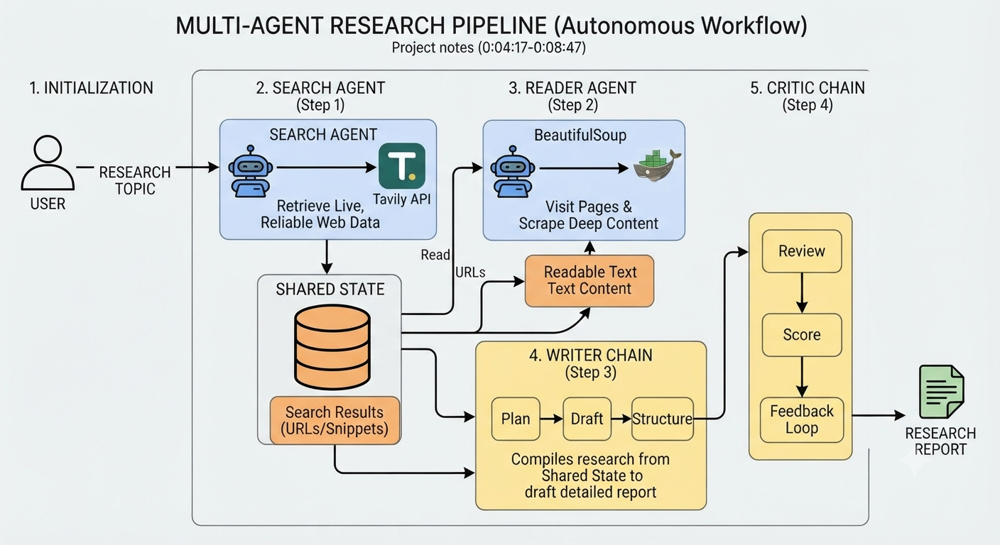

#  Multi-Agent AI Research System

It is an AI-powered research assistant that uses a **multi-agent architecture** to automate the process of researching topics and generating structured research reports.

Built with Streamlit and LangChain, the system coordinates four specialized AI components that search the web, extract detailed information, generate research reports, and evaluate the final output.

## ✨ Features

- **Search Agent:** Finds recent, reliable, and relevant information about a given research topic.
- **Reader Agent:** Scrapes selected web resources and extracts detailed content for deeper research.
- **Writer Chain:** Combines search results and extracted content to generate a structured research report.
- **Critic Chain:** Reviews the generated report and provides feedback.
- **Live Pipeline Tracking:** Displays the progress of each stage of the research workflow.
- **Report Download:** Allows users to download the final research report in Markdown (`.md`) format.
- **Interactive Interface:** Provides a modern, responsive interface built with Streamlit and custom CSS.

## 🏗️ System Architecture

It follows a sequential multi-agent workflow:



## 🛠️ Tech Stack

| Category | Technologies |
|---|---|
| Programming Language | Python |
| Frontend | Streamlit, HTML, CSS |
| AI Framework | LangChain |
| Architecture | Multi-Agent AI System |
| Language Models | Configured through agent and chain modules |
| Web Research | Web Search and Web Scraping |

## 📂 Project Structure

```text
Multi-Agent/
│
├── app.py                  # Streamlit application
├── agents.py               # Agent and chain definitions
├── pipeline.py 
├── tools.py               
├── requirements.txt        # Project dependencies
├── .env                    # API keys and environment variables
├── .gitignore              # Ignored files
│
└── README.md               # Project documentation
```

*Note: Adjust the file structure according to your actual project.*

## ⚙️ Installation & Setup

### 1. Clone the Repository

```bash
git clone https://github.com/anubhab23-27/Multi-Agent-AI-Research-System.git
cd Multi-Agent-Reasearch-System
```

### 2. Create a Virtual Environment

```bash
python -m venv venv
```

Activate the environment:

**Windows:**
```bash
venv\Scripts\activate
```

**Linux / macOS:**
```bash
source venv/bin/activate
```

### 3. Install Dependencies

```bash
pip install -r requirements.txt
```

### 4. Configure Environment Variables

Create a `.env` file in the root directory and add the API keys required by your agent and chain implementations.

```env
# Add your required API keys here
```

Never upload your API keys or `.env` file to GitHub.

### 5. Run the Application

```bash
streamlit run app.py
```

The application will open in your default browser.

## 🚀 How It Works

1. Enter a research topic in the input field.
2. Click **Run Research Pipeline**.
3. The Search Agent gathers relevant web information.
4. The Reader Agent selects a relevant URL and extracts deeper content.
5. The Writer Chain generates a comprehensive research report using the collected information.
6. The Critic Chain evaluates the generated report and provides feedback.
7. View the final report and download it as a Markdown file.

## 🎯 Example Research Topics

- Large Language Models and AI Agents
- Quantum Computing Breakthroughs
- CRISPR Gene Editing
- Renewable Energy and Fusion Technology

## 🔮 Future Improvements

- Add source citations and reference links to generated reports.
- Implement parallel agent execution for improved efficiency.
- Introduce iterative report refinement based on critic feedback.
- Add PDF and DOCX export functionality.
- Maintain research history and allow users to revisit previous reports.
- Improve source verification and factual consistency.

## 👨‍💻 Author

**Anubhab Ghosh**

B.Tech – Computer Science and Engineering (AI & ML)

[GitHub](https://github.com/anubhab23-27)

---

*Turning research topics into structured insights through collaborative AI agents.*# Multi-Agent-AI-Research-System
